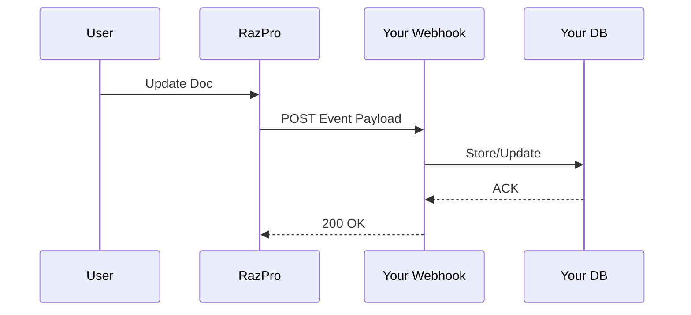

## Overview

RazPro supports seamless integrations with popular tools to streamline your documentation processes. Import content from GitHub repositories or Markdown files, set up notifications via Slack or email, automate workflows with API webhooks, and export your docs to PDF or other formats. These features help you maintain up-to-date documentation without manual effort.

<Callout kind="info">
  Enable integrations in your RazPro dashboard under Settings > Integrations. Ensure you have admin permissions.
</Callout>

## Supported Integrations

Discover key integrations at a glance.

<Columns cols={2}>
  <Card title="GitHub Import" icon="github" href="https://dashboard.razpro.us/integrations/github">
    Sync Markdown files directly from your GitHub repos into RazPro spaces.
  </Card>
  <Card title="Slack Notifications" icon="message-circle" href="https://dashboard.razpro.us/integrations/slack">
    Get real-time alerts for updates, comments, and approvals.
  </Card>
  <Card title="API Webhooks" icon="zap" href="https://dashboard.razpro.us/integrations/webhooks">
    Trigger custom automations on doc events like publishes or edits.
  </Card>
  <Card title="PDF Export" icon="file-text" href="https://dashboard.razpro.us/integrations/export">
    Generate and download professional PDF versions of your docs.
  </Card>
</Columns>

## GitHub and Markdown Import

Import your existing documentation effortlessly.

<Steps>
  <Step title="Connect GitHub" icon="github">
    Authorize RazPro in your GitHub account settings.
  </Step>
  <Step title="Select Repository" icon="folder">
    Choose the repo and branch containing your Markdown files.
  </Step>
  <Step title="Map Files" icon="settings">
    Specify paths to import, like `docs/*.md`, and sync automatically on pushes.
  </Step>
</Steps>

<Tabs>
  <Tab title="GitHub CLI" icon="terminal">
````bash
gh auth login
gh repo sync razpro/docs --webhook https://api.razpro.us/v1/import/github
````
  </Tab>
  <Tab title="Markdown Direct" icon="file-text">
````bash
curl -X POST https://api.razpro.us/v1/import/markdown \
  -H "Authorization: Bearer YOUR_API_KEY" \
  -F "file=@docs/intro.md"
````
  </Tab>
</Tabs>

## Notifications Setup

Configure alerts for your team.

<Tabs>
  <Tab title="Slack" icon="message-circle">
    <Steps>
      <Step title="Create Slack App">
        Add RazPro webhook URL to your Slack app incoming webhooks.
      </Step>
      <Step title="Subscribe Events">
        Select events like `doc.updated` or `comment.new`.
      </Step>
    </Steps>

````javascript
// Example Slack payload
const payload = {
  text: "New doc published: {doc.title}",
  channel: "#docs"
};
````
  </Tab>
  <Tab title="Email" icon="mail">
    Enter recipient emails in RazPro settings. Supports templates for custom subjects.
  </Tab>
</Tabs>

## API Webhooks for Automation

Webhooks enable powerful automations. RazPro sends HTTP POST requests to your endpoint on trigger events.



<ParamField path="event" param-type="string" required="true">
  Event type, e.g., `doc.published`, `page.updated`.
</ParamField>

<ParamField header="X-RazPro-Signature" param-type="string" required="false">
  HMAC signature for payload verification using your webhook secret.
</ParamField>

<Request tabs="cURL,JavaScript">
````bash
curl -X POST https://api.razpro.us/v1/webhooks \
  -H "Authorization: Bearer YOUR_API_KEY" \
  -d '{"url": "https://your-webhook-url.com/razpro", "events": ["doc.published"]}'
````

````javascript
const response = await fetch('https://api.razpro.us/v1/webhooks', {
  method: 'POST',
  headers: {
    'Authorization': 'Bearer YOUR_API_KEY',
    'Content-Type': 'application/json'
  },
  body: JSON.stringify({
    url: 'https://your-webhook-url.com/razpro',
    events: ['doc.published']
  })
});
````
</Request>

<Response tabs="200,400">
```json
{
  "success": true,
  "webhook_id": "wh_123abc",
  "events": ["doc.published"]
}
```

```json
{
  "error": "Invalid URL",
  "code": 400
}
```
</Response>

<Expandable title="Verify Webhook Signature" default-open="false">
  Use Node.js crypto to validate incoming payloads.

<CodeGroup tabs="Node.js,Python">
```javascript
const crypto = require('crypto');
const signature = req.headers['x-razpro-signature'];
const hmac = crypto.createHmac('sha256', 'YOUR_WEBHOOK_SECRET');
hmac.update(JSON.stringify(payload));
const expected = 'sha256=' + hmac.digest('hex');
if (signature !== expected) throw new Error('Invalid signature');
```

```python
import hmac
import hashlib
signature = request.headers.get('X-RazPro-Signature')
expected = hmac.new(
  b'YOUR_WEBHOOK_SECRET',
  payload,
  hashlib.sha256
).hexdigest()
if signature != f'sha256={expected}':
  raise ValueError('Invalid signature')
```
</CodeGroup>
</Expandable>

## Export to PDF and More

Export your documentation for sharing or archiving.

<Callout kind="tip">
  Exports include all images, links, and formatting. Use for client reports or offline access.
</Callout>

Supported formats: PDF, HTML, Markdown ZIP.

```bash
curl -X POST https://api.razpro.us/v1/export/pdf \
  -H "Authorization: Bearer YOUR_API_KEY" \
  -d '{"space_id": "spc_123", "pages": ["intro", "guide"]}'
```

<Board title="Integration Status">
  <BoardColumn title="Active" color="2" icon="check-circle">
    <BoardCard title="GitHub Sync" description="Repos importing daily" icon="github" />
    <BoardCard title="Slack Alerts" description="Team notifications live" icon="message-circle" />
  </BoardColumn>
  <BoardColumn title="Pending" color="1" icon="loader">
    <BoardCard title="PDF Exporter" dueDate="2024-12-15" />
  </BoardColumn>
  <BoardColumn title="Planned" color="0" icon="circle-dot">
    <BoardCard title="Zapier Support" description="No-code automations" icon="zap" />
  </BoardColumn>
</Board>